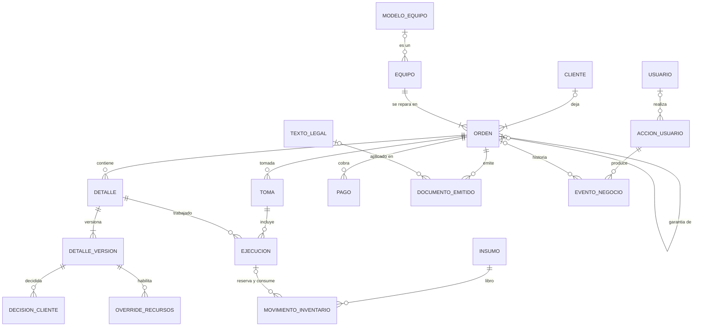
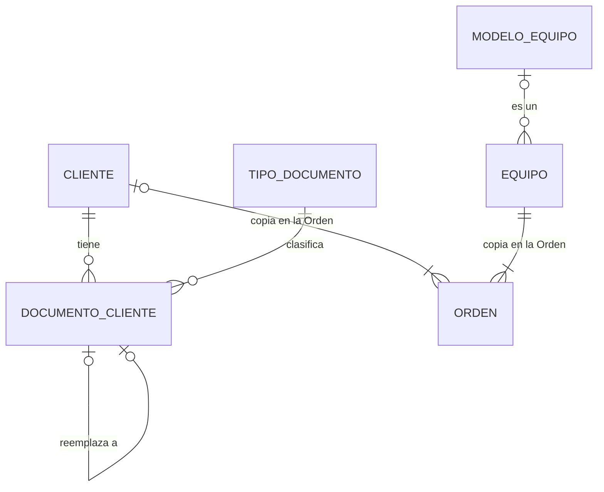
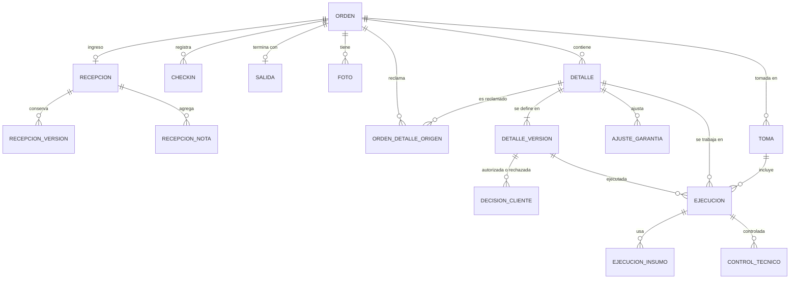
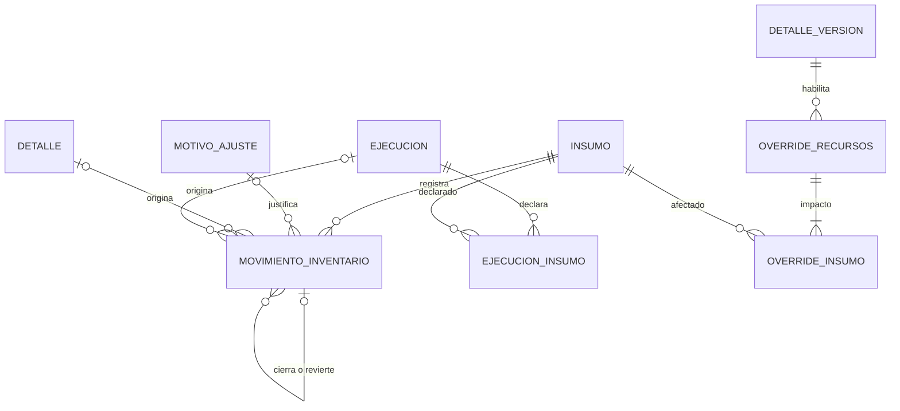
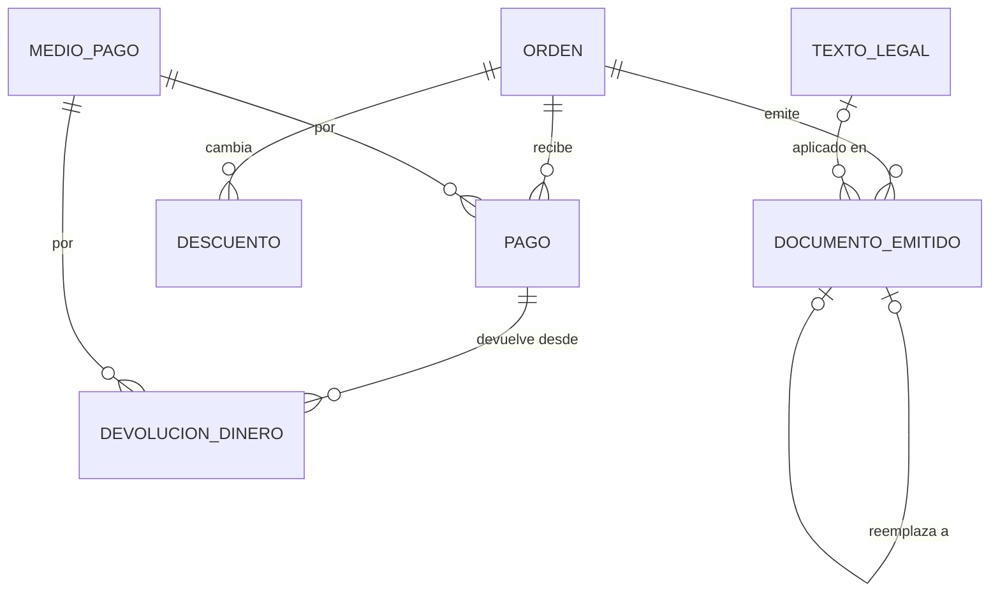
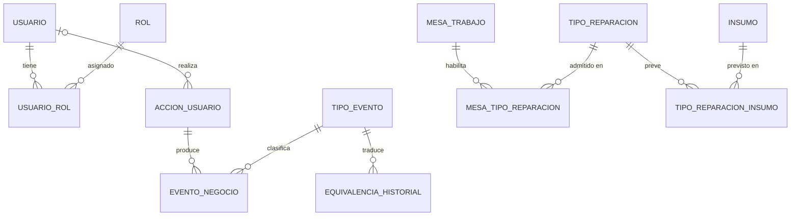
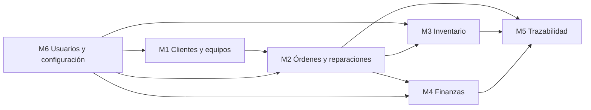

# Rosario Tecno RMA — Diseño lógico PostgreSQL

**Estado:** aprobado. **Fecha:** 02/11/2026.
- **Revisión 2:** incorpora la aprobación y las correcciones del responsable de producto (sección G).
- **Revisión 3:** registra los ajustes técnicos del diseño físico aprobados el 02/11/2026 (sección J).

El esquema que lo implementa está en `supabase/migrations/` y su informe en `docs/postgresql/diseno-fisico.md`.

**Fuentes:**
- `rt-rma-mvp`, rama `mvp-v2`, versión UAT `6516d4c`: modelos Pydantic, servicios, repositorios, persistencia JSON y `docs/pendientes-producto.md`.
- `rt-rma-app` `main` `c79fea1`: baseline V1.4, registro de decisiones y diseño lógico V1.4.
- Diseño lógico del 28/10/2026 y decisiones aprobadas posteriores (ABI-16, ABI-22, ABI-24, contactos, eventos, validación progresiva).

**Qué es.** El modelo lógico que reemplaza la persistencia JSON del MVP en Supabase PostgreSQL. Conserva el comportamiento de la UAT y deja previstas las funciones aprobadas.

**Qué no es.** No es el diseño físico: no fija tipos, índices, nombres definitivos de columnas ni SQL.

**Convenciones.**
- Los nombres de entidad son los propuestos para las tablas.
- **ID** es el identificador interno, opaco, que usan las relaciones.
- **Código** es el identificador legible de negocio que ven las personas y la API actual.
- Estado de cada entidad:
  - *Existente*: igual que en el MVP.
  - *Adaptada*: existe con otra forma, por ejemplo embebida en el JSON de la Orden.
  - *Nueva*.
  - *Futura*: no se crea en esta etapa.

---

## A. Resumen ejecutivo

### Alcance

El modelo cubre todo lo que el MVP persiste hoy:
- las Órdenes, que hoy son un JSON por archivo con todo lo que cuelga de ellas;
- los catálogos y la configuración (`catalogs/*.json`);
- el catálogo técnico de modelos (`app/datos/modelos_equipo.json`);
- los movimientos de stock;
- las referencias a fotos.

Suma solo las estructuras que exigen las decisiones aprobadas:
- Cliente con documentos (ABI-24);
- versiones de la definición del Detalle (ABI-16);
- libro único de inventario con motivos y registro del override (ABI-22, P-06);
- trazabilidad con acción de usuario, catálogo de eventos y equivalencias;
- roles por usuario para Supabase Auth.

### Entidades por módulo

| Módulo | Entidades | Nuevas |
|---|---|---|
| M1. Clientes y equipos | 4 | 1 |
| M2. Órdenes y reparaciones | 16 | 1 |
| M3. Inventario y abastecimiento | 4 | 2 |
| M4. Administración, finanzas y contabilidad | 4 | 0 |
| M5. Trazabilidad y auditoría | 5 | 4 |
| M6. Usuarios, permisos y configuración | 12 | 4 |
| **Total** | **45** | **12** |

Además, una entidad futura: el permiso configurable.

La revisión 2 suma una sola entidad, `texto_legal`, por una razón: el comprobante de entrega tiene que reproducirse con los Términos y Condiciones vigentes al emitirlo, y hoy ese texto vive en el código del frontend.

Frente al diseño del 28/10 (49 entidades), el modelo se simplificó:
- Las copias históricas de Cliente y Equipo pasan a ser atributos de la Orden.
- Las personas que entregan y retiran el equipo pasan a ser atributos de la Recepción y de la Salida.
- La cancelación del Detalle y la anulación del pago pasan a ser atributos, porque son 0..1.
- El tipo de movimiento pasa a ser un dominio enumerado.
- El catálogo de Ventas deja de tener tablas.

Se agregaron:
- el catálogo técnico de modelos de equipo;
- la autorización de override con su impacto por insumo.

### Decisiones de arquitectura principales

1. **La Orden es la unidad de consistencia.** Toda operación sobre una Orden bloquea su fila y confirma en una sola transacción:
   - los cambios funcionales;
   - los movimientos de stock;
   - los eventos.

   Esto reemplaza la sección crítica del proceso, permite varias instancias de Cloud Run y resuelve la doble escritura de los pasos 210 y 211.
2. **El estado actual se guarda; los derivados se calculan.** Se guardan:
   - el estado de workflow, la posición en el proceso y la prioridad de la Orden;
   - el estado, la condición y el control del Detalle;
   - los estados de la Ejecución y de la toma;
   - el stock físico y el reservado del insumo, que nunca dejan el disponible negativo.

   Se calculan, como hoy:
   - el total, el saldo y el estado de cobro;
   - la custodia;
   - la situación técnica;
   - el pendiente de autorización;
   - el stock disponible.
3. **Nada se borra.** Los registros se corrigen con registros nuevos y los catálogos se desactivan. Las únicas actualizaciones son las del estado actual y los datos que se completan una sola vez, como la anulación de un pago.
4. **Las copias históricas son atributos de la entidad que las usa.**
   - La copia de Cliente y Equipo, en la Orden.
   - Precio, puntaje y garantía, en la versión de definición.
   - El contenido de cada comprobante, en el documento emitido.
5. **Los eventos de negocio se guardan con su cambio, en la misma transacción.** El historial que hoy muestra la pantalla sale de los eventos visibles, con el mismo formato.
6. **Acceso solo desde FastAPI.** El frontend no lee tablas. Supabase Auth autentica y FastAPI autoriza.

### Diferencias con la V1.4 que el modelo adopta

Son decisiones de UAT posteriores a la baseline o comportamientos vigentes que no se restablecen.

| Tema | V1.4 | Lo que modela este diseño |
|---|---|---|
| Override por falta de stock (BR-REP-003) | Solo el Coordinador RMA; la reserva puede exceder el disponible y el consumo deja el físico negativo | P-06: cualquier rol, con motivo y confirmación; reserva solo lo disponible; descuenta a lo sumo lo reservado y existente; lo usado de más queda sin respaldo, sin deuda futura |
| Stock disponible (BR-REP-049) | El disponible puede ser negativo por un override o un faltante | El disponible nunca es negativo: el físico no baja del reservado. Un ajuste que lo haría se rechaza. Es un cambio funcional pendiente en el MVP (sección H) |
| Evaluación técnica previa (BR-REP-035/036, nodos 182 a 184) | Obligatoria | No existe (PC-01). No hay entidad de evaluación técnica |
| Identidad del equipo (DC20, BR-REP-048) | Catálogo de Ventas como referencia comercial | Catálogo técnico propio de RMA. El `tp_id` de Ventas queda solo como dato histórico |
| Accesorios | Se piden al ingresar | Ya no se piden; el atributo se conserva para las Órdenes que los tienen |
| Check-in (ABI-32) | Un check-in vigente | Varios registros; el vigente es el último, como en la implementación |
| Descuento (DC11, ABI-10) | La cortesía total puede dejar saldo a favor | No puede dejar el total por debajo de lo cobrado, como hoy |
| Desistimiento (DC07) | Solicitud y cancelación separadas | Una sola decisión que cancela, como hoy |
| Quién define los Detalles (DC06, PC-02) | El Técnico | Hoy Recepción. PC-02 lo cambia antes de producción sin cambiar el modelo: la versión guarda quién la definió, sea cual sea su rol |
| Permisos (DC08) | Configurables | Fijos en el código; roles por usuario |
| Estado terminal de RT_INTERNO (ABI-27) | Pendiente | Como hoy: REPARACION_LISTA con el proceso cerrado |

---

## B. Modelo relacional

### M1. Clientes y equipos

#### `cliente` — Adaptada
- **Propósito:** persona física o jurídica que deja equipos de cliente externo o de garantía RMA.
- **ID:** interno. **Código:** ninguno; el ID actual del Cliente embebido se conserva como identificador público.
- **Atributos:**
  - tipo de persona (física o jurídica);
  - nombre y apellido o razón social, en un único campo;
  - teléfono y email;
  - alta (quién y cuándo).
  - Prevista, sin uso: la clasificación Minorista o Mayorista (DC19).
- **Relaciones:** 1..N `orden`; 0..N `documento_cliente`.
- **Restricciones:**
  - el ID nunca cambia;
  - sin fusión en esta etapa;
  - las correcciones son eventos con valor anterior y nuevo.
- **MVP:** `orden.cliente`, embebido en cada Orden, con un ID que se conserva entre Órdenes. La búsqueda por DNI recorre las Órdenes.

#### `documento_cliente` — Nueva
- **Propósito:** un documento de identidad de un Cliente, con su historia de correcciones.
- **ID:** interno.
- **Atributos:**
  - tipo;
  - número tal como se cargó y número normalizado;
  - vigente desde y hasta;
  - quién lo registró;
  - documento que lo reemplaza.
- **Relaciones:** N..1 `cliente`; N..1 `tipo_documento`.
- **Restricciones:**
  - como máximo uno vigente por Cliente y tipo;
  - tipo y número normalizado únicos entre los documentos vigentes cuando el tipo exige unicidad;
  - el documento es opcional.
- **MVP:** `Cliente.dni`. Hoy una corrección queda solo en la Orden nueva, sin el valor anterior.

#### `modelo_equipo` — Adaptada
- **Propósito:** catálogo técnico de RMA, que dice qué equipo es.
- **ID:** interno. **Código:** `MOD-0001`, estable.
- **Atributos:**
  - marca, modelo y variante (vacía en la versión estándar);
  - números de modelo del fabricante, como lista (P-02);
  - activo.
- **Relaciones:** 0..N `equipo`.
- **Restricciones:**
  - marca, modelo y variante no se repiten;
  - un modelo no se borra: se desactiva.
- **MVP:** `ModeloEquipo` en `app/datos/modelos_equipo.json`, versionado con el código y generado una vez desde Ventas.
- **Por qué los números del fabricante son una lista y no una entidad:** el buscador los usa, pero no tienen atributos propios ni otras relaciones.

#### `equipo` — Adaptada
- **Propósito:** la unidad física.
- **ID:** interno; el ID actual se conserva como identificador público.
- **Atributos:**
  - IMEI y número de serie, opcionales;
  - modelo técnico, opcional en la carga manual;
  - capacidad en GB y texto original de la capacidad;
  - color.
- **Relaciones:** 1..N `orden`: la de origen y sus garantías RMA. 0..1 `modelo_equipo`.
- **Restricciones:**
  - el IMEI no es la identidad;
  - no hay reutilización por IMEI en un ingreso nuevo (ABI-05): cada ingreso crea su Equipo, como hoy.
- **MVP:** `orden.equipo`. La garantía lo copia con el mismo ID, así que el Equipo ya pertenece a varias Órdenes.
- **Capacidad:**
  - hoy es texto libre y la API no la recibe;
  - elegir un modelo la borra (P-01);
  - se normaliza a GB, con 1 TB = 1024 GB, y lo que no se pueda convertir queda en el texto original;
  - que sea obligatoria en RT_INTERNO es P-01, pendiente de implementar.

**Sin tabla:** las copias históricas de Cliente y Equipo son atributos de `orden`. El catálogo comercial de Ventas no tiene tablas: su `tp_id` queda como atributo histórico de la Orden, sin relación. La interfaz ya no lo usa; los endpoints de sincronización siguen sobre su repositorio JSON hasta que se retiren (ver G).

### M2. Órdenes y reparaciones

#### `orden` — Adaptada
- **Propósito:** unidad de gestión del proceso y límite de consistencia.
- **ID:** interno. **Código:** `OR-000001`, por secuencia.
- **Atributos:**
  - origen: CLIENTE_EXTERNO, RT_INTERNO o RMA_GARANTIA_REPARACION;
  - estado de workflow;
  - posición en el proceso: último nodo o EVT-REP-999;
  - prioridad: 1 a 4, 0 sin priorizar; los valores históricos fuera de escala se conservan;
  - referencia RT;
  - Orden de origen, en una garantía;
  - **copia del Cliente:** Cliente, tipo de persona, nombre, documento principal, teléfono y email;
  - **copia del Equipo:** Equipo, modelo técnico, marca, modelo, variante, capacidad, color y `tp_id` histórico;
  - falla reportada;
  - versión;
  - último número de evento;
  - creada, modificada y cerrada.
- **Relaciones:**
  - N..1 `cliente`, vacío en RT_INTERNO;
  - N..1 `equipo`;
  - 0..1 `orden` de origen;
  - 0..N `detalle`: la Orden se crea antes de definir sus reparaciones;
  - 0..1 `recepcion` y 0..1 `salida`;
  - 0..N de cada entidad dependiente.
- **Estados:** REQUERIMIENTO, EN_REVISION, HABILITADA, EN_COLA, EN_REPARACION, REPARACION_LISTA, ENTREGADA y CANCELADA. Está cerrada si está ENTREGADA o en EVT-REP-999.
- **Restricciones:**
  - una Orden cerrada no se modifica (E1);
  - RT_INTERNO no tiene Cliente;
  - una garantía referencia una Orden ENTREGADA;
  - se crea sin Detalles;
  - la versión aumenta en cada cambio;
  - las copias no cambian después del ingreso, salvo una corrección de recepción antes de confirmar la custodia, que guarda la versión anterior.
- **MVP:** `OrdenReparacion`, un archivo JSON por Orden. El número se calcula buscando el máximo. La falla reportada vive hoy en el Equipo.

#### `orden_detalle_origen` — Adaptada
- **Propósito:** qué Detalles de la Orden de origen reclama una garantía.
- **ID:** la Orden de garantía y el Detalle.
- **Relaciones:** N..1 `orden` de garantía; N..1 `detalle` de la Orden de origen.
- **Restricción:** el Detalle pertenece a la Orden de origen.
- **MVP:** `detalles_origen_ids`.

#### `recepcion` — Existente
- **Propósito:** ingreso físico y decisión de custodia.
- **ID:** la Orden (0..1).
- **Atributos:**
  - cómo nació: ingreso o regularización;
  - estado físico, accesorios, observaciones y notas internas;
  - quién la registró y cuándo;
  - **persona que entrega el equipo:** nombre, documento y teléfono opcionales, y vínculo con el Cliente;
  - confirmación (quién, cuándo, observaciones) o «no recibido» (quién, cuándo, motivo).
- **Relaciones:** 1..1 `orden`; 0..N `recepcion_version`; 0..N `recepcion_nota`.
- **Restricciones:**
  - la custodia se decide una sola vez;
  - decidida, solo se agregan notas;
  - una Orden sin recepción es la situación SIN_REGISTRO.
- **MVP:** `RecepcionEquipo`. Quién entrega el equipo no se registra hoy: la estructura queda prevista y pedirlo en pantalla es un cambio funcional para aprobar.

#### `recepcion_version` — Existente
- **Propósito:** datos del ingreso y del equipo reemplazados por una corrección.
- **ID:** interno.
- **Atributos:** datos y equipo anteriores; quién los registró y cuándo; quién los reemplazó y cuándo.
- **Restricción:** solo existe antes de decidir la custodia.
- **MVP:** `VersionRecepcion`.

#### `recepcion_nota` — Existente
- **Propósito:** nota posterior al ingreso.
- **ID:** interno.
- **Atributos:** texto; interna o visible; quién y cuándo.
- **Restricción:** una nota interna nunca sale en un documento.
- **MVP:** `NotaRecepcion`.

#### `checkin` — Adaptada
- **Propósito:** verificación de funciones básicas antes de entregar.
- **ID:** interno.
- **Atributos:** realizado o no; quién y cuándo.
- **Relaciones:** N..1 `orden`.
- **Restricciones:**
  - inmodificable;
  - el vigente es el último;
  - registrarlo reasigna la garantía sugerida de cada Detalle, en la misma transacción.
- **MVP:** `registros_checkin` dentro de la recepción, más el dato vigente copiado en los datos del ingreso.

#### `salida` — Adaptada
- **Propósito:** entrega de una reparación terminada o devolución sin reparar, incluida la devolución a Gestión RT.
- **ID:** la Orden (0..1).
- **Atributos:**
  - tipo de salida;
  - usuario que entrega;
  - **persona que retira:** nombre, documento y teléfono opcionales, y vínculo con el Cliente;
  - fecha y observaciones.
- **Restricciones:**
  - una salida por Orden;
  - la devolución no convierte una CANCELADA en ENTREGADA.
- **MVP:** campos `entrega` y `devolucion`. Hoy la devolución a Gestión RT no deja registro de salida, solo una entrada en el historial.

#### `foto` — Existente
- **Propósito:** referencia a una foto del equipo.
- **ID:** interno; el ID actual se conserva como identificador público.
- **Atributos:** clave del objeto en el almacenamiento; tipo; tamaño; nombre original; quién y cuándo.
- **Restricciones:**
  - como máximo 10 por Orden;
  - la imagen vive fuera de la base, en el bucket actual.
- **MVP:** `FotoOrden`.

#### `detalle` — Adaptada
- **Propósito:** un trabajo de la Orden, con identidad estable y estado actual.
- **ID:** interno. **Código:** `DET-001`, único dentro de la Orden.
- **Atributos:**
  - versión vigente;
  - estado y condición;
  - control vigente: estado, quién, cuándo y observaciones;
  - garantía definitiva y sugerida;
  - Detalle de origen, en una garantía;
  - observaciones;
  - **cancelación:** origen (interna, rechazo del cliente o desistimiento), motivo, quién y cuándo.
- **Relaciones:**
  - N..1 `orden`;
  - 1..N `detalle_version`;
  - 0..N `ejecucion`, `control_tecnico`, `ajuste_garantia` y `movimiento_inventario`;
  - 0..1 `detalle` de origen.
- **Estados:**
  - estado: DEFINIDO, EN_PROGRESO, COMPLETO o CANCELADO;
  - condición: SIN_BLOQUEO, REQUIERE_DEFINICION o BLOQUEADO_POR_RECURSOS;
  - control: PENDIENTE o APROBADO.
- **Restricciones:**
  - la versión vigente pertenece al Detalle;
  - no se cancela un Detalle EN_PROGRESO;
  - COMPLETO solo vuelve a DEFINIDO por un rechazo en el control;
  - un Detalle CANCELADO no tiene reservas activas;
  - el Detalle no se borra.
- **MVP:** `ReparacionDetail` y `RegistroCancelacion`.

#### `detalle_version` — Nueva (ABI-16)
- **Propósito:** una definición del Detalle, inmutable.
- **ID:** interno; número 1..n dentro del Detalle.
- **Atributos:**
  - tipo de reparación, o «Otros» con descripción;
  - precio, puntaje y garantía copiados del catálogo;
  - quién la definió y cuándo, sea cual sea su rol (PC-02);
  - motivo, en una redefinición;
  - versión que reemplaza.
- **Relaciones:** N..1 `detalle`; 0..N `decision_cliente`, `ejecucion` y `override_recursos`.
- **Restricciones:**
  - la versión 1 siempre existe;
  - el Detalle y el número no se repiten;
  - una redefinición crea la siguiente versión y no modifica las anteriores.
- **MVP:** campos del Detalle (la vigente) y `DefinicionAnteriorDetalle` (las reemplazadas). Hoy la versión se calcula.

#### `decision_cliente` — Existente
- **Propósito:** autorización o rechazo de una versión.
- **ID:** interno.
- **Atributos:**
  - resultado: AUTORIZADO o RECHAZADO;
  - canal;
  - quién la registró y cuándo;
  - observaciones.
- **Relaciones:** N..1 `detalle_version`.
- **Restricciones:**
  - solo en cliente externo;
  - «sin respuesta» no se registra;
  - el pendiente se deriva de la versión vigente sin decisión;
  - una redefinición no hereda la decisión.
- **MVP:** `RegistroAutorizacionCliente`, con el número de versión.

#### `ajuste_garantia` — Existente
- **Propósito:** cambio manual del plazo de garantía.
- **ID:** interno.
- **Atributos:** días anteriores y nuevos; motivo; quién y cuándo.
- **Restricción:** un ajuste manual nunca lo pisa el check-in.
- **MVP:** `AjusteGarantia`.

#### `toma` — Existente
- **Propósito:** participación activa de un técnico sobre la Orden.
- **ID:** interno; el ID actual se conserva como identificador público.
- **Atributos:** técnico; Mesa; inicio y fin; quién la liberó y por qué, si no fue su titular.
- **Estados:** ACTIVA o CERRADA.
- **Restricciones:**
  - como máximo una ACTIVA por Orden;
  - ninguna ACTIVA en una Orden cerrada.
- **MVP:** `TomaOrden`.

#### `ejecucion` — Existente
- **Propósito:** un trabajo concreto sobre un Detalle.
- **ID:** interno; el ID actual se conserva como identificador público.
- **Atributos:**
  - Detalle;
  - versión ejecutada;
  - toma y técnico;
  - inicio y fin;
  - observaciones;
  - motivo de interrupción o de redefinición.
- **Estados:** EN_PROGRESO, COMPLETADO o INTERRUMPIDO.
- **Restricciones:**
  - como máximo una EN_PROGRESO por Orden;
  - una Ejecución terminada no se reabre.
- **MVP:** `EjecucionReparacion`. Hoy la versión ejecutada no se guarda; en la migración se deduce por fecha.

#### `ejecucion_insumo` — Existente
- **Propósito:** lo que el técnico declara como utilizado en una Ejecución terminada, por insumo.
- **ID:** la Ejecución y el insumo.
- **Atributos:** cantidad utilizada declarada.
- **Restricciones:**
  - sin override, la cantidad declarada no supera lo reservado;
  - es inmutable.
- **MVP:** `InsumoUtilizado`.

**Una sola fuente de verdad por cantidad:**

| Cantidad | Dónde se guarda | Cómo se obtiene |
|---|---|---|
| Utilizada declarada | `ejecucion_insumo` | Lo que informa el técnico |
| Efectivamente consumida | `movimiento_inventario` | Suma de los CONSUMO de esa Ejecución e insumo |
| Sin respaldo de stock | No se guarda | Declarada menos consumida; solo puede ser mayor que cero con override |

El evento de cierre conserva además, como evidencia, el texto que hoy registra el paso 210.

#### `control_tecnico` — Existente
- **Propósito:** cada aprobación o rechazo.
- **ID:** interno.
- **Atributos:** Ejecución controlada; resultado; quién y cuándo; observaciones.
- **Restricción:** el control vigente del Detalle es el último.
- **MVP:** `RegistroControlTecnico`.

**Sin entidad propia:**
- la custodia y la situación técnica, que se calculan;
- la evaluación técnica previa, que no existe (PC-01);
- la solicitud de desistimiento, futura (DC07).

### M3. Inventario y abastecimiento

#### `insumo` — Existente
- **Propósito:** repuesto o material con stock.
- **ID:** interno. **Código:** el código legible actual.
- **Atributos:**
  - nombre y unidad;
  - **stock físico** y **stock reservado**, ambos guardados;
  - activo.
- **Relaciones:** 0..N `movimiento_inventario`; 0..N `tipo_reparacion_insumo`.
- **Restricciones:**
  - el reservado no es negativo;
  - **el físico nunca es menor que el reservado**, así que el disponible (físico − reservado, calculado) nunca es negativo y el físico tampoco;
  - la base garantiza las dos reglas, no solo la aplicación;
  - físico y reservado cambian solo junto con su movimiento, en la misma transacción.
- **MVP:** `insumos.json`. Hoy el reservado se calcula recorriendo todas las Órdenes; guardarlo permite bloquear el insumo y decidir con un valor consistente. Hoy un ajuste negativo puede dejar el disponible negativo con una confirmación: en este diseño se rechaza (cambio funcional, sección H).

#### `movimiento_inventario` — Adaptada (ABI-22)
- **Propósito:** libro único e inmutable.
- **ID:** interno; el ID actual se conserva como identificador público.
- **Atributos:**
  - tipo;
  - insumo;
  - cantidad, siempre mayor que cero;
  - fecha;
  - responsable, vacío si lo registra el sistema;
  - Orden, Detalle y Ejecución, cuando corresponde;
  - movimiento de origen;
  - motivo de ajuste y texto;
  - referencia;
  - clave de operación;
  - stock anterior y resultante;
  - reservado y disponible al registrarlo;
  - observación.
- **Tipos** (dominio enumerado):
  - RESERVA, LIBERACION_RESERVA, CONSUMO, INGRESO, AJUSTE_POSITIVO y AJUSTE_NEGATIVO;
  - DESPERDICIO y DEVOLUCION, definidos y sin operación habilitada.
- **Relaciones:** N..1 `insumo`; 0..1 movimiento de origen; N..1 `motivo_ajuste` opcional.
- **Restricciones:**
  - CONSUMO, LIBERACION_RESERVA y DESPERDICIO cierran una RESERVA del mismo insumo, Orden y Detalle, sin superar lo pendiente;
  - DEVOLUCION referencia un CONSUMO y no supera lo consumido menos lo ya devuelto;
  - INGRESO y los ajustes no tienen Orden ni tocan reservas; los ajustes exigen un motivo;
  - un AJUSTE_NEGATIVO no puede dejar el físico por debajo del reservado;
  - una referencia de ingreso no se repite por insumo;
  - inmutable.
- **MVP:** dos estructuras: `MovimientoInsumo`, dentro de cada Orden, y `MovimientoStock`, en `movimientos_stock.json`. El consumo hoy reescribe el stock sin un movimiento de stock propio.

#### `override_recursos` — Nueva (P-06)
- **Propósito:** autorización para trabajar un Detalle bloqueado por falta de stock.
- **ID:** interno.
- **Atributos:** versión de definición; motivo; quién (cualquier rol) y cuándo.
- **Relaciones:** N..1 `detalle_version`; 1..N `override_insumo`.
- **Restricciones:**
  - vale solo para la versión que referencia, así que una redefinición lo anula por construcción;
  - nunca es automático.
- **MVP:** solo existe como entrada ACC-REP-049 del historial, y su vigencia se deduce recorriéndolo.

#### `override_insumo` — Nueva
- **Propósito:** el impacto que el usuario confirmó, por insumo.
- **ID:** el override y el insumo.
- **Atributos:** requerido, disponible, a reservar y faltante.
- **Restricción:** inmutable; es la evidencia de lo confirmado.
- **MVP:** texto del paso ACC-REP-049.

**El override sin stock negativo (P-06), en el modelo:**
- **Al iniciar** se reserva min(requerido, disponible), sin tocar reservas ajenas. El faltante no se reserva nunca y queda anotado en el evento de inicio.
- **Al terminar** se descuenta min(utilizado, reservado, físico − reservado de otras Órdenes). El resto de la reserva se libera.
- **Lo usado de más** no genera movimiento ni deuda para una reposición futura. Es la diferencia entre lo declarado en `ejecucion_insumo` y lo consumido en el libro.

**Regularización de reservas.** Si el conteo físico es menor que lo reservado, primero se liberan las reservas que correspondan con una operación explícita y después se ajusta. Nunca se liberan reservas de otras Órdenes automáticamente.

En la primera versión, la operación explícita es la que ya existe: interrumpir la Ejecución que tiene la reserva, lo que libera lo no usado en el paso 210. Una operación dedicada para liberar reservas sería funcionalidad nueva y no se diseña ahora.

Compras y abastecimiento no se modelan. Cuando llegue Compras, los INGRESO ganan una referencia a su comprobante de compra.

### M4. Administración, finanzas y contabilidad

RMA administra solo los aspectos económicos de sus reparaciones. No implementa contabilidad general: sus registros quedan disponibles para un futuro módulo contable independiente (ver el final de esta sección).

#### `pago` — Existente
- **Propósito:** dinero recibido del cliente.
- **ID:** interno; el ID actual se conserva como identificador público.
- **Atributos:**
  - monto, mayor que cero;
  - tipo: ANTICIPO, PARCIAL o FINAL (PAGO, solo histórico);
  - medio;
  - referencia;
  - clave de operación;
  - quién y cuándo;
  - **anulación:** quién, cuándo y motivo.
- **Relaciones:** N..1 `orden`, `medio_pago`; 0..N `devolucion_dinero`.
- **Restricciones:**
  - el monto no cambia;
  - la anulación se completa una sola vez y solo por Administración;
  - solo en Órdenes cobrables;
  - la Orden y la clave de operación no se repiten.
- **MVP:** `Pago` y `AnulacionPago`.

#### `devolucion_dinero` — Existente
- **Propósito:** dinero devuelto desde un pago.
- **ID:** interno.
- **Atributos:** pago de origen; monto; medio; motivo; referencia; clave de operación; quién y cuándo.
- **Restricciones:**
  - no supera lo cobrado de ese pago ni el saldo a favor;
  - no es un pago negativo.
- **MVP:** `DevolucionDinero`.

#### `descuento` — Existente
- **Propósito:** cada cambio del descuento de la Orden.
- **ID:** interno.
- **Atributos:** porcentaje o importe y su valor, o vacío si se quita; motivo; quién y cuándo.
- **Restricciones:**
  - el vigente es el último, salvo que lo quite;
  - no cambia precios;
  - no deja el total por debajo de lo cobrado.
- **MVP:** `RegistroDescuento`.

#### `documento_emitido` — Existente
- **Propósito:** cada versión de un comprobante.
- **ID:** interno.
- **Atributos:**
  - tipo: ING, recepción, AUT, entrega o garantía;
  - versión;
  - fecha y quién;
  - motivo y versión reemplazada, en una corrección;
  - **contenido completo**, como un único dato;
  - **versión del texto legal** aplicado, cuando el documento lo lleva (hoy, el comprobante de entrega de una reparación terminada);
  - **versión de la plantilla** con la que se presentó;
  - **archivo emitido**, previsto: clave del PDF guardado en el almacenamiento y su huella.
- **Relaciones:** N..1 `orden`; 0..1 versión que reemplaza; N..1 `texto_legal` opcional.
- **Restricciones:**
  - la Orden, el tipo y la versión no se repiten;
  - el contenido, el texto legal y la plantilla de un documento emitido nunca cambian;
  - una versión nueva exige motivo.
- **MVP:** `DocumentoEmitido`, más las marcas de documento generado de Órdenes anteriores, que se conservan como atributos de la Orden. Hoy el texto de los Términos y Condiciones está en el código del frontend y no queda registrado con el documento.

**Reproducción histórica.**
- **El contenido** se reproduce siempre: la copia de los datos y el texto legal son inmutables y el documento los referencia.
- **El aspecto** se reproduce con la versión de la plantilla. Mientras los comprobantes de entrega y garantía se impriman desde el navegador, cambiar su diseño exige conservar la plantilla anterior para los documentos ya emitidos.
- **La garantía completa** es guardar el PDF al emitirlo. Hoy el backend solo genera el PDF de ING y AUT; generar y guardar el de entrega y garantía es un cambio funcional (sección H). El atributo queda previsto.

**Total, saldo y estado de cobro** se calculan como hoy: saldo = total − pagado vigente + devuelto. No se guardan.

**Integración futura con Contabilidad.** Pagos, anulaciones, devoluciones y documentos ya tienen todo lo que un módulo contable necesitaría consumir: identificadores estables, fecha, importe, medio, Orden y comprobante, y además son inmutables. No se crean asientos, plan de cuentas, libros ni datos fiscales. Cuando exista ese módulo, podrá leer estos registros o sus eventos.

### M5. Trazabilidad y auditoría

#### `accion_usuario` — Nueva
- **Propósito:** cada pedido que cambia datos.
- **ID:** interno.
- **Atributos:**
  - usuario y su rol en ese momento, o el proceso del sistema;
  - operación;
  - fecha;
  - **clave de idempotencia**;
  - resultado.
- **Relaciones:** 1..N `evento_negocio`.
- **Restricción:** la clave de idempotencia es única: un reintento devuelve el resultado anterior.
- **MVP:** no existe. Hoy hay claves de operación sueltas en pagos, devoluciones y movimientos de stock.

#### `evento_negocio` — Adaptada
- **Propósito:** un hecho del dominio, en orden.
- **ID:** interno; número de secuencia dentro de la Orden.
- **Atributos:**
  - tipo;
  - Orden, o Cliente o Insumo si no hay Orden;
  - fecha;
  - responsable (Usuario o Sistema), usuario y rol;
  - acción;
  - Detalle, Ejecución o Pago afectados;
  - nodo del proceso;
  - estado anterior y nuevo;
  - datos propios del tipo;
  - observación;
  - **en los heredados:** identificador, acción y observación originales.
- **Relaciones:** N..1 `tipo_evento`, `accion_usuario`, `orden`.
- **Restricciones:**
  - inmutable;
  - la secuencia por Orden no se repite y reproduce el orden histórico;
  - se guarda en la transacción del cambio que registra.
- **MVP:** `HistorialWorkflow`, dentro de la Orden.

#### `tipo_evento` — Nueva
- **Propósito:** catálogo de los 51 eventos de negocio.
- **ID:** código en un espacio nuevo, que no reutiliza ACC-REP.
- **Atributos:** nombre; entidad; si se muestra en el historial actual.
- **Restricción:** un código nunca cambia de significado.

#### `equivalencia_historial` — Nueva
- **Propósito:** traducir cada entrada heredada a un tipo de evento.
- **ID:** tipo de referencia, identificador y acción originales.
- **Restricción:** resuelve los choques de ACC-REP-021 a 028 sin renumerar. Las entradas de ACC-REP-060 se distinguen por el documento al que apuntan (ING o AUT).

#### `auditoria_tecnica` — Nueva
- **Propósito:** lo que no es negocio.
- **ID:** interno.
- **Atributos:** tipo; usuario o proceso; fecha; detalle.
- **Contenido en la primera versión:**
  - operaciones rechazadas por permiso;
  - errores de integridad;
  - limpieza de fotos.

  La auditoría de configuración llega con su administración.
- **MVP:** solo los registros del servidor (logs).

**Las cinco capas:**
- **Estado actual:** atributos de las entidades.
- **Reglas de transición:** viven en el código del dominio, como hoy, no en tablas.
- **Evento de negocio:** `evento_negocio`.
- **Auditoría técnica:** `auditoria_tecnica`.
- **Historial visible:** una consulta sobre los eventos marcados como visibles, con el formato de respuesta actual.

### M6. Usuarios, permisos y configuración

| Entidad | Estado | Propósito, identificador y atributos | Restricciones | MVP |
|---|---|---|---|---|
| `usuario` | Adaptada | Persona que opera. ID interno vinculado a la identidad de Supabase Auth. Nombre, email, activo | Un usuario inactivo no opera. Los usuarios de demostración no pasan a producción | `usuarios.json`, más el login dummy del frontend |
| `rol` | Existente | Código RECEPCION, TECNICO, COORDINADOR_RMA o ADMINISTRADOR; nombre | Catálogo fijo | Enum `RolUsuario` |
| `usuario_rol` | Nueva | Usuario y rol; desde cuándo y quién lo otorgó | Los permisos efectivos son la unión de los roles | Un único rol por usuario |
| `mesa_trabajo` | Existente | Código, nombre, activa | Se desactiva, no se borra | `estaciones.json` |
| `mesa_tipo_reparacion` | Existente | Mesa y tipo de reparación | «Otros» no restringe Mesas | `tipo_reparacion_estaciones.json` |
| `tipo_reparacion` | Existente | Código (TR-OTROS reservado), nombre, precio, puntaje, garantía en días, activo | Se desactiva, no se borra; cambiarlo no altera versiones de definición | `tipos_reparacion.json` |
| `tipo_reparacion_insumo` | Existente | Tipo, insumo y cantidad prevista | Cantidad mayor que cero; «Otros» no tiene insumos previstos | `tipo_reparacion_insumos.json` |
| `medio_pago` | Existente | Código, nombre, activo, si admite devolución | Se desactiva, no se borra | `medios_pago.json` |
| `tipo_documento` | Nueva | Código (DNI, CUIT...), nombre, a qué tipo de persona aplica, regla de normalización, si exige unicidad, activo | La regla del DNI es la actual: solo dígitos, 7 u 8, sin ceros a la izquierda | Solo DNI, validado en el código |
| `motivo_ajuste` | Nueva | Código, descripción, si aplica a positivos, negativos o ambos, activo | Un motivo dado de baja se conserva en sus movimientos | Texto libre |
| `empresa` | Existente | Una fila: nombre, razón social, CUIT, dirección, teléfono, email, condiciones de garantía | Cambiarla no altera los documentos emitidos | `empresa.json` |
| `texto_legal` | Nueva | Tipo (Términos y Condiciones del comprobante de entrega), versión, texto con sus cláusulas y destacados, vigente desde | Una versión es inmutable; hay una sola vigente por tipo; un documento emitido apunta a la que usó | `terminosCondiciones.ts`, en el código del frontend |
| `permiso` | Futura | Rol, acción y contexto (DC08) | — | Constantes `ROLES_*` en los servicios |

Los Términos y Condiciones pasan a ser datos versionados (`texto_legal`), con su contenido actual como versión 1. Lo que dicen sigue en revisión (P-04, P-05); una corrección es una versión nueva y no altera los documentos ya emitidos.

No hay un motor genérico de configuración ni pantallas de administración: los catálogos y los textos legales se cargan por migración o semilla, como hoy por archivo.

---

## C. Diagramas ER

### General simplificado

Notación: el símbolo de cada extremo indica cuántas filas de esa entidad corresponden a una fila del otro extremo. `||` uno exactamente, `|o` cero o uno, `|{` uno o más, `o{` cero o más.

### General simplificado

### M1. Clientes y equipos

Un Cliente existe solo con al menos una Orden; una Orden RT_INTERNO no tiene Cliente. Un Equipo existe solo con al menos una Orden y cada Orden tiene exactamente un Equipo.

### M2. Órdenes y reparaciones

Una Orden puede no tener Detalles (se crea antes de definirlos) y una toma puede cerrarse sin haber iniciado ninguna Ejecución. Cada Detalle tiene al menos una versión.

### M3. Inventario y abastecimiento

### M4. Administración, finanzas y contabilidad

### M5 y M6. Trazabilidad, usuarios y configuración

Una acción rechazada no produce eventos; queda con su resultado y, si corresponde, en la auditoría técnica. Las acciones del sistema no tienen usuario.

---

## D. Reglas transaccionales

### Principios

1. **Una operación, una transacción.** Cada comando abre una transacción que incluye:
   - la acción de usuario;
   - los cambios funcionales;
   - los movimientos y el stock;
   - los documentos;
   - los eventos.

   Si algo falla, no se confirma nada. Desaparecen la compensación entre archivos y la doble escritura de los pasos 210 y 211.
2. **Orden fijo de bloqueo:**
   1. el Cliente, si la operación lo cambia;
   2. la Orden;
   3. los insumos, de menor a mayor ID.

   Siempre se bloquea en ese orden, así no hay bloqueos cruzados.
3. **Revalidar con datos frescos.** Las precondiciones se evalúan después de bloquear y con lo que la base tiene en ese momento, como hoy dentro de la sección crítica.
4. **Sin estado en el proceso.** Ni la consistencia ni el orden dependen de que Cloud Run tenga una sola instancia. Los bloqueos son de la transacción y son compatibles con el pooler de Supabase en modo transacción.

### Operaciones críticas

| Operación | Bloquea | Se confirma junto |
|---|---|---|
| Crear una Orden | Ninguna fila existente; las unicidades protegen | Código de Orden por secuencia; Cliente nuevo o reutilizado y sus documentos; Equipo; Orden con sus copias; recepción; acción y eventos. Si otra alta tomó el mismo documento, falla y se ofrece reutilizar el Cliente |
| Ingreso inicial completo (ING) | Orden | Detalles con su versión 1; decisiones de autorización; confirmación de custodia; comprobante ING; factibilidad (lee stock, no reserva); habilitación; prioridad y cola; eventos |
| Crear o redefinir un Detalle | Orden | Detalle y versión 1, o versión n+1 con la condición limpia. El override anterior deja de valer porque apunta a otra versión. Eventos y versión de la Orden |
| Autorizar o rechazar una versión | Orden | Decisión sobre la versión vigente (se rechaza si ya no es la vigente); reevaluación de la situación; eventos |
| Aplicar override | Orden y sus insumos | Override con su impacto por insumo, calculado con el stock bloqueado; si la Orden esperaba recursos, habilitación; eventos |
| Reservar e iniciar una Ejecución | Orden e insumos previstos | RESERVA por insumo (completa sin override; min(requerido, disponible) con override); reservado del insumo; Ejecución; Detalle EN_PROGRESO; Orden EN_REPARACION; eventos. Sin stock y sin override no se confirma nada; la reserva fallida es otra transacción, solo con sus eventos |
| Completar, interrumpir o redefinir; consumir y liberar (210 + 211) | Orden e insumos del Detalle | Resultado de la Ejecución; `ejecucion_insumo` con lo declarado; CONSUMO y LIBERACION_RESERVA; físico y reservado; estado y condición del Detalle; situación de la Orden (cierre de toma, cola, espera); eventos, con lo sin respaldo como evidencia. **Una sola transacción** |
| Registrar un cobro | Orden | Pago; condición de entrega reevaluada; eventos |
| Anular un pago | Orden y pago | Anulación (solo si está vacía); condición de entrega; eventos |
| Devolver dinero | Orden | Devolución; saldo a favor verificado; cierre del proceso si ya no queda saldo; eventos |
| Control técnico | Orden | Control; control vigente del Detalle; si todo está aprobado, puntaje y REPARACION_LISTA; eventos |
| Check-in | Orden | Registro; garantía sugerida de cada Detalle sin ajuste manual; eventos |
| Entregar y cerrar | Orden | Salida con quien retira; ENTREGADA, posición EVT-REP-999 y fecha de cierre; comprobante de entrega (con su texto legal vigente) y garantía; eventos. Verifica saldo cero, check-in, sin toma ni reservas activas |
| Emitir un documento | Orden | Documento con versión siguiente por tipo, su contenido, la versión de texto legal vigente y la de plantilla; eventos. Si se guarda el PDF, el archivo se sube antes y la referencia se confirma dentro |
| Corregir un documento de identidad | Cliente | Documento anterior reemplazado; documento nuevo con la unicidad verificada; evento con valor anterior y nuevo |
| Ingreso o ajuste de stock | Insumo | Movimiento con motivo; físico; eventos. Un ajuste negativo que dejaría el físico por debajo del reservado se rechaza |
| Agregar una foto | Orden | Referencia y evento. El objeto se sube antes, fuera de la transacción: un fallo deja como mucho un objeto huérfano |
| Registrar eventos | — | Siempre dentro de la transacción de su operación. La secuencia se toma del contador de la Orden bloqueada |

### Integridad de inventario

- **Bloqueo y valor guardado.** El stock físico y el reservado se guardan en el insumo y cambian solo junto con su movimiento, con el insumo bloqueado. Dos reservas simultáneas del mismo insumo se atienden una detrás de otra y la segunda ve el reservado actualizado.
- **Restricciones de la base:**
  - cantidad mayor que cero;
  - reservado no negativo;
  - **físico mayor o igual que el reservado**: el disponible nunca es negativo;
  - vínculos obligatorios según el tipo de movimiento;
  - movimiento de origen del mismo insumo;
  - referencia de ingreso única por insumo;
  - movimientos sin modificación ni borrado.
- **Reglas que verifica la aplicación bajo bloqueo:**
  - no cerrar más de lo pendiente de una reserva;
  - descontar a lo sumo lo existente con override;
  - rechazar con un mensaje claro el ajuste que dejaría el físico por debajo del reservado, antes de que lo rechace la base.
- **Conciliación con el libro:**
  - Para cada insumo, el físico guardado es igual a la suma de los efectos de sus movimientos, y el reservado guardado es igual a la suma de sus reservas pendientes (cada RESERVA menos lo que la cierra).
  - Para cada `ejecucion_insumo`, lo consumido en el libro no supera lo declarado.
  - Se verifica en todas las pruebas de integración y con una consulta periódica en producción.
  - Una diferencia se registra en la auditoría técnica y se avisa; nunca se corrige sola.

### Por qué el disponible no puede quedar negativo

Con el físico mayor o igual que el reservado en todo momento, ninguna operación de la primera versión puede violarlo:
- **Una reserva** sin override exige disponible suficiente; con override reserva a lo sumo lo disponible (P-06).
- **Un consumo** baja el físico y el reservado en la misma cantidad.
- **Una liberación** solo baja el reservado.
- **Un ingreso o un ajuste positivo** solo sube el físico.
- **Un ajuste negativo** es la única operación que puede romper la regla. Se rechaza si la rompería; antes hay que regularizar las reservas con una operación explícita, sin tocar automáticamente las de otras Órdenes.

### Integridad de pagos

- **Lo que se guarda no cambia:** los importes son mayores que cero y no se modifican, y la anulación se completa una sola vez.
- **Lo que se verifica bajo el bloqueo de la Orden:**
  - una devolución no supera lo cobrado de su pago ni el saldo a favor;
  - un descuento no deja el total por debajo de lo cobrado.
- **El saldo se calcula siempre:** no se guarda, así que no puede desincronizarse.

### Idempotencia

**Cómo funciona.**
- La pantalla genera una clave por intento de operación y la reenvía igual en cada reintento.
- La clave se guarda en `accion_usuario`, única por usuario, junto con el resultado confirmado.
- Un reintento con la misma clave devuelve ese resultado sin repetir efectos.
- Reemplaza y generaliza las claves de operación actuales de pagos, devoluciones y movimientos de stock.

**Obligatoria** en las operaciones críticas que se pueden reintentar y que, repetidas, crearían otro registro o moverían dinero o stock dos veces. La API las rechaza sin clave:

| Operación | Qué evita |
|---|---|
| Crear una Orden | Una Orden duplicada |
| Registrar un cobro | Un cobro duplicado |
| Devolver dinero | Una devolución duplicada |
| Ingreso o ajuste de stock | Un movimiento duplicado |
| Iniciar una Ejecución | Una respuesta de conflicto en lugar del resultado |
| Completar, interrumpir o redefinir una Ejecución | Una respuesta de conflicto en lugar del resultado |
| Entregar o devolver el equipo | Una respuesta de conflicto en lugar del resultado |
| Emitir una versión nueva de un documento | Una versión de más |
| Agregar una foto | Una foto duplicada |
| Registrar una decisión del cliente | Una decisión repetida |
| Aplicar un override | Un override repetido |

En las operaciones de cierre la base ya impide repetir el efecto: una sola Ejecución en curso, una salida por Orden, una Ejecución terminada no se reabre. La clave hace que el reintento reciba el resultado original y no un error de conflicto.

**No hace falta clave** en:
- las consultas;
- las operaciones cuyo efecto repetido es el mismo: cambiar la prioridad al mismo valor, confirmar una custodia ya decidida, anular un pago ya anulado (se rechaza sin efecto).

Hoy la pantalla envía clave solo en cobros, devoluciones y movimientos de stock. Exigirla en las demás es un cambio funcional (sección H). Mientras no esté hecho, esas operaciones conservan su idempotencia natural.

**Idempotencias naturales que se conservan:**
- una Ejecución cerrada no vuelve a mover stock;
- el inventario de una Ejecución se aplica una sola vez;
- una referencia de ingreso no se repite.

### Unicidad
- **Unicidades:**
  - clave de idempotencia por usuario;
  - documento vigente por tipo y número;
  - toma activa por Orden;
  - Ejecución en curso por Orden;
  - código de Orden;
  - código de Detalle por Orden;
  - número de versión por Detalle;
  - tipo y versión de documento por Orden;
  - salida por Orden;
  - secuencia de eventos por Orden;
  - código de modelo técnico;
  - marca, modelo y variante del modelo técnico.

---

## E. Alcance

### Imprescindible para operar RMA con PostgreSQL

Las 45 entidades de los seis módulos, que conservan:
- la funcionalidad de la UAT (`6516d4c`), incluido el override de P-06;
- las transacciones de la sección D;
- la consulta del historial visible con su formato actual;
- Supabase Auth con los roles por usuario.

### Previsto para integraciones futuras, sin operación

- La clasificación Minorista o Mayorista del Cliente.
- Los tipos de movimiento DESPERDICIO y DEVOLUCION.
- La referencia de un INGRESO a un comprobante de compra.
- La lectura de pagos, devoluciones y documentos por un futuro módulo contable.
- Más de una Orden por Equipo, para cuando se reutilice por IMEI.
- La persona que entrega el equipo: su captura en pantalla necesita aprobación.
- El PDF guardado de cada documento emitido.

### No se implementa en esta etapa

- **Fuera de RMA:**
  - Contabilidad: asientos, plan de cuentas, libros, lógica fiscal;
  - Compras, lotes y costos;
  - Reporting.
- **Funciones de RMA que esperan su propia aprobación:**
  - permisos configurables;
  - fusión de Clientes;
  - reutilización de Equipos por IMEI;
  - operaciones de DESPERDICIO y DEVOLUCION;
  - solicitud de desistimiento separada;
  - ajuste comercial por Detalle y cortesía;
  - política y excepción de garantía;
  - checklist, firmas, comunicaciones y consentimiento;
  - rediseño del historial visible.
- **Configuración e infraestructura:**
  - historial de precios y auditoría de configuración;
  - motor de configuración y pantallas de administración;
  - tablas del catálogo de Ventas;
  - migración de los datos de UAT a producción.

---

## F. Plan de construcción

### Orden de creación de tablas

1. **Catálogos sin dependencias:** `rol`, `tipo_documento`, `motivo_ajuste`, `medio_pago`, `mesa_trabajo`, `tipo_reparacion`, `insumo`, `modelo_equipo`, `empresa`, `texto_legal`, `tipo_evento`.
2. **Relaciones de configuración:** `usuario`, `usuario_rol`, `mesa_tipo_reparacion`, `tipo_reparacion_insumo`, `equivalencia_historial`.
3. **M1:** `cliente`, `documento_cliente`, `equipo`.
4. **M5 base:** `accion_usuario`.
5. **M2 núcleo:**
   - `orden`, `orden_detalle_origen`;
   - `recepcion`, `recepcion_version`, `recepcion_nota`;
   - `detalle`, `detalle_version`, `decision_cliente`, `ajuste_garantia`.
6. **M2 taller:** `toma`, `ejecucion`, `ejecucion_insumo`, `control_tecnico`.
7. **M3:** `override_recursos`, `override_insumo`, `movimiento_inventario`.
8. **M2 cierre y M4:**
   - `checkin`, `salida`, `foto`;
   - `pago`, `devolucion_dinero`, `descuento`, `documento_emitido`.
9. **M5:** `evento_negocio`, `auditoria_tecnica`.
10. **Consultas de compatibilidad:** historial visible y reservas pendientes.

### Estrategia de migraciones SQL

- **Migraciones versionadas en `rt-rma-mvp`** con la CLI de Supabase: una por módulo, solo hacia adelante y revisadas como código. Nunca se aplican a mano en producción.
- **Dos clases de datos de carga:**
  - Los datos de referencia, que son parte del modelo, van en las migraciones: roles, tipos de documento, tipos de evento y equivalencias.
  - La carga inicial de cada entorno va aparte: catálogos reales, stock inicial como INGRESO con su motivo, Mesas, medios de pago, empresa y usuarios.
- **Entornos:**
  - local, con Supabase en Docker;
  - un proyecto o rama de prueba, que se puede recrear;
  - producción, que arranca vacía, sin Órdenes, Clientes ni usuarios de UAT.
- **Acceso:**
  - FastAPI se conecta con una credencial de servicio;
  - las tablas no son accesibles para clientes anónimos ni autenticados directamente: seguridad por filas activa y sin políticas de acceso directo.

### Pruebas de integridad

- **Restricciones:** cada unicidad y cada vínculo obligatorio de la sección D tiene una prueba que intenta violarlo.
- **Invariantes:**
  - conciliación de cada insumo con el libro (sección D);
  - físico mayor o igual que el reservado en cada insumo;
  - una sola versión vigente por Detalle;
  - secuencia de eventos sin repetidos;
  - saldo frente a pagos y devoluciones;
  - lo consumido no supera lo declarado.
- **Concurrencia, con varias conexiones simultáneas:**
  - dos reservas del mismo insumo que juntas superan el disponible;
  - un ajuste negativo simultáneo con una reserva del mismo insumo;
  - dos altas con el mismo documento;
  - dos cierres de la misma Ejecución;
  - cada operación con clave obligatoria, reintentada con la misma clave;
  - dos tomas de la misma Orden.
- **Documentos:** un comprobante emitido se reproduce igual después de publicar una versión nueva del texto legal.
- **Compatibilidad:**
  - la suite actual del backend corre contra PostgreSQL y da el mismo resultado que contra JSON;
  - importación de copias de datos de UAT y de los datos de prueba a un entorno de prueba, con ida y vuelta: cada Orden se vuelve a cargar y se compara con su JSON;
  - los calculados (saldo, custodia, situación técnica, reservas) y el historial visible coinciden.

  La importación es una herramienta de prueba; producción no la usa.

  Las copias de UAT pueden tener insumos con disponible negativo, porque se generaron antes de P-06 o con un ajuste confirmado. La importación los informa y no los carga tal cual: la base nueva los rechaza, como corresponde.

### Adaptación progresiva de FastAPI

1. **Unidad de trabajo y repositorios PostgreSQL**, con los mismos contratos: `OrdenReparacionRepository`, `CatalogosRepository` y `ModelosEquipoRepository`.
   - El repositorio carga y guarda el mismo agregado Pydantic, traducido a las tablas, y los servicios no cambian.
   - Cada comando corre en una transacción, que reemplaza las secciones críticas.
   - Las escrituras de stock y de la Orden comparten esa transacción, así que el riesgo de 210 y 211 queda resuelto.
2. **Consultas propias** para lo que hoy recorre todas las Órdenes: número siguiente, búsqueda por documento, reservas pendientes, bandejas e historial visible.
3. **Estructuras nuevas en los servicios:**
   - versiones de definición;
   - override como entidad;
   - `ejecucion_insumo` con la cantidad declarada; lo consumido sale del libro y lo sin respaldo se calcula;
   - Cliente con documentos;
   - acción de usuario y eventos tipificados.

   Ninguna cambia las respuestas de la API.
4. **Supabase Auth.** FastAPI toma al usuario del token en lugar del cuerpo del pedido y el login dummy se retira. Cambia el contrato con el frontend y es un requisito de producción: se planifica como un cambio propio.

Mientras dure la transición, el repositorio JSON se mantiene para las pruebas comparativas y como repositorio de los endpoints del catálogo de Ventas.

### Compatibilidad que se preserva

- **Contratos y API:**
  - los contratos Pydantic y las respuestas de la API son los mismos;
  - los identificadores públicos son los actuales: OR-, DET-, MOD-, códigos de catálogo y los IDs de tomas, Ejecuciones, movimientos, pagos y fotos;
  - el frontend no cambia, salvo por Supabase Auth.
- **Contenido histórico:**
  - los documentos se reproducen desde su contenido guardado;
  - el historial visible es el mismo, entrada por entrada.
- **Valores heredados** que se leen igual que hoy en las pruebas de importación:
  - el tipo de pago PAGO;
  - las prioridades fuera de escala;
  - el check-in guardado en los datos del ingreso;
  - las Órdenes sin recepción;
  - las marcas de documento sin copia emitida;
  - el `tp_id` de Ventas;
  - la capacidad en texto.

---

## G. Decisiones cerradas

Aprobadas por el responsable de producto el 02/11/2026. No quedan decisiones abiertas que bloqueen el esquema físico.

| N.º | Decisión | Resolución | Dónde impacta |
|---|---|---|---|
| G-1 | Identificadores | **Aprobada.** ID interno opaco para las relaciones; los identificadores públicos actuales (OR-, DET- por Orden, MOD-, códigos de catálogo, IDs de tomas, Ejecuciones, movimientos, pagos y fotos) como valores únicos de negocio | Todas las entidades |
| G-2 | Stock físico negativo | **No aprobada la propuesta; se adopta la regla contraria.** El físico nunca es menor que el reservado y el disponible nunca es negativo, garantizado por la base. Un ajuste que lo rompería se rechaza; antes hay que regularizar las reservas con una operación explícita. Nunca se liberan reservas de otras Órdenes automáticamente | `insumo`, `movimiento_inventario`, sección D; cambio funcional H-1 |
| G-3 | Reservado guardado en `insumo` | **Aprobada.** Físico y reservado se actualizan solo en la transacción de sus movimientos, con conciliación contra el libro | `insumo`, sección D |
| G-4 | Catálogo de Ventas sin tablas | **Aprobada provisionalmente.** Se conserva el `tp_id` histórico y la compatibilidad actual; Ventas no es una dependencia del catálogo técnico | `orden`, `equipo` |
| G-5 | Acceso solo desde FastAPI | **Aprobada.** Sin acceso directo del frontend a las tablas; Supabase Auth autentica y FastAPI autoriza | Plan de migraciones |
| G-6 | Cardinalidad Orden–Detalle | **Corregida a 0..N**, en el texto y en todos los diagramas. También se corrigieron Toma–Ejecución (0..N), Acción–Evento (0..N) y Cliente–Orden (cada Cliente tiene al menos una Orden; RT_INTERNO no tiene Cliente) | Secciones B y C |
| G-7 | Cantidades de `ejecucion_insumo` | **Corregida.** Se guarda solo lo declarado; lo consumido sale del libro y lo sin respaldo se calcula. No hay valores que puedan contradecirse | `ejecucion_insumo`, M3, sección D |
| G-8 | Reproducción histórica de documentos | **Resuelta.** Los Términos y Condiciones pasan a ser datos versionados (`texto_legal`, entidad nueva); el documento guarda la versión del texto y la de la plantilla. El PDF guardado queda previsto | `texto_legal`, `documento_emitido`; cambios H-2 y H-3 |
| G-9 | Idempotencia | **Definida.** Clave obligatoria en las operaciones críticas que se pueden reintentar (cobros, devoluciones, movimientos de stock, cierres, alta de Orden, documentos, fotos, decisiones, override); no se exige en las consultas | Sección D; cambio funcional H-4 |
| G-10 | Módulo 4 | **Renombrado** «Administración, finanzas y contabilidad», sin contabilidad general: sus registros quedan disponibles para un módulo contable independiente | M4 |

El total queda en **45 entidades**: las 44 aprobadas más `texto_legal`, justificada por G-8.

## H. Cambios funcionales que requiere el MVP

Ninguno impide crear el esquema. Tienen que estar implementados antes de que el MVP opere sobre PostgreSQL con las restricciones de este diseño.

| N.º | Cambio | Hoy | Qué cambia | Impacto |
|---|---|---|---|---|
| H-1 | **Ajuste negativo sin disponible negativo** (G-2) | Un ajuste negativo puede dejar el disponible negativo si el usuario confirma la advertencia (`services/inventario_operativo.py`) | Se rechaza si dejaría el físico por debajo del reservado, con un mensaje que indica cuánto está reservado y por qué Órdenes. Para corregir un conteo menor, primero se interrumpe la Ejecución que tiene la reserva, que libera lo no usado, y después se ajusta | Mínimo: una validación en el backend, el mensaje en la pantalla de inventario y sus pruebas. Desaparece el último caso de stock negativo del MVP (P-06, punto 3 de «Falta»). Requiere actualizar BR-REP-049 en una evolución posterior a la V1.4 |
| H-2 | **Términos y Condiciones como dato versionado** (G-8) | El texto está en `terminosCondiciones.ts` y el comprobante de entrega lo toma del código del frontend al imprimir | El backend registra la versión vigente al emitir el comprobante y entrega su texto con el documento; el frontend imprime ese texto en lugar del propio | Backend y frontend. El texto actual pasa a ser la versión 1, sin cambiar lo que se imprime |
| H-3 | **Versión de plantilla y PDF guardado** (G-8) | Los comprobantes de entrega y garantía se imprimen desde el navegador; el backend genera solo el PDF de ING y AUT | Registrar la versión de plantilla en cada emisión. Más adelante, generar y guardar el PDF al emitir | El registro de la versión es mínimo. Guardar el PDF es una mejora prevista, no requisito de la primera versión; mientras no exista, un cambio de diseño exige conservar la plantilla anterior |
| H-4 | **Clave de idempotencia obligatoria** (G-9) | La pantalla envía clave solo en cobros, devoluciones y movimientos de stock | La pantalla genera y reenvía una clave en todas las operaciones de la lista de la sección D, y la API la exige | Frontend y API. Hasta implementarlo, esas operaciones conservan su idempotencia natural |

Siguen vigentes, sin cambios por este diseño:
- **Requisito de producción:** autenticación con Supabase Auth y retiro del login dummy.
- **Cambio previsto antes de producción:** PC-02, la definición de Detalles por el Técnico.
- **Pendientes de producto:** P-01 a P-05.

## I. Estado del diseño

**El diseño lógico está listo para generar las migraciones del esquema físico.**
- Las cinco decisiones de arquitectura están cerradas (G-1 a G-5) y las correcciones de consistencia aplicadas (G-6 a G-10).
- Los diagramas usan la notación de cardinalidad de Mermaid y coinciden con las relaciones del texto.
- El orden de creación de las tablas (sección F) incluye `texto_legal`.

Los cambios funcionales de la sección H se implementan aparte y no cambian el esquema: el esquema ya incluye la restricción de stock, la versión del texto legal y de la plantilla, y la clave de idempotencia.

## J. Ajustes técnicos aprobados en el diseño físico

Aprobados por el responsable de producto el 02/11/2026. No agregan entidades ni funcionalidades.

| N.º | Ajuste | Motivo |
|---|---|---|
| J-1 | **La versión vigente del Detalle se calcula:** es la de mayor número (vista `v_detalle_version_vigente`) y no se guarda en el Detalle | Evita una clave foránea circular entre `detalle` y `detalle_version` |
| J-2 | **Tipo de evento técnico `EV-SIS-001` «Paso de decisión del proceso»,** además de los 51 de negocio | Los pasos de decisión que hoy aparecen en el historial visible (010, 045, 050, 068, 110, 211, 212) necesitan un tipo sin presentarse como eventos de negocio |
| J-3 | **Registro de la salida a Gestión RT** en `salida`, con el tipo `DEVOLUCION_GESTION_RT` y el vínculo `GESTION_RT` | Hoy esa devolución no deja registro de salida |
| J-4 | **El ingreso inicial de inventario lo registra un proceso del sistema,** sin usuario | El stock inicial se carga por proceso; los ajustes manuales siguen exigiendo usuario |
| J-5 | **Los datos ficticios de UAT con inventario incompatible no se migran a producción** | La base rechaza un disponible negativo (G-2); producción arranca sin datos de UAT |

Ajustes técnicos posteriores, de la auditoría previa a aplicar las migraciones, que no cambian el diseño lógico:
- La acción de usuario admite completar **una sola vez** su respuesta y su Orden: se inserta al comienzo de la transacción, porque los eventos la referencian, y la respuesta se conoce al final.
- **El libro de inventario no admite `INSERT ... ON CONFLICT`:** aplica los saldos antes de que PostgreSQL resuelva un conflicto. Los reintentos se resuelven con la clave de idempotencia de la acción.
